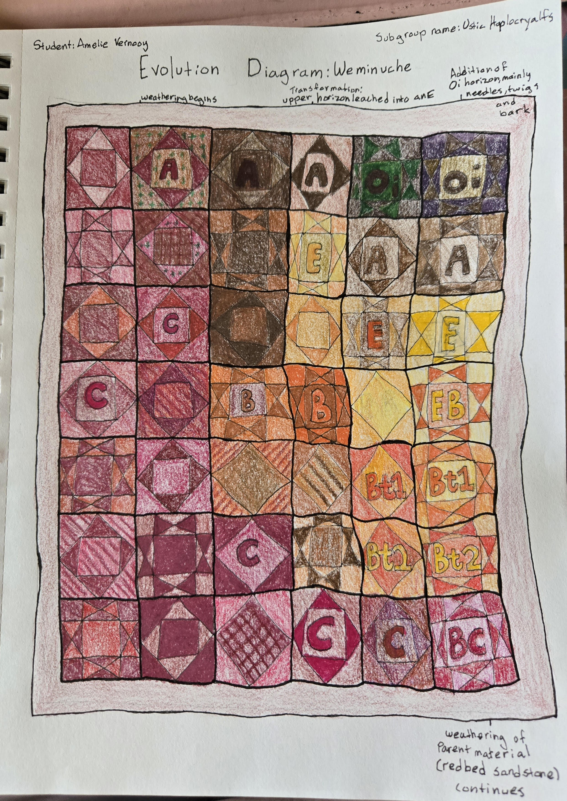

## Classification
| Level | Name |
| --- | --- |
| Series: | Weminuche |
| Order: | Alfisols |
| Suborder: | Cryalfs |
| Great group: | Haplocryalfs |
| Subgroup: | Ustic Haplocryalfs |
| Family: | Fine-loamy, mixed, superactive Ustic Haplocryalfs |

## DRoCTS+ table

| Horizon | Depth (in) | Rocks (%) | Color (dry) | Texture | Structure | Effervescence (HCl) | pH |
| --- | --- | --- | --- | --- | --- | --- | --- | 
| Oi |	0-2	|	Not Given |	p	| -	| ne | 5.6 |
| A	| 2-4	| 6%	| 5YR 3/3	| l/fsl	| pl/gr	| ne	| 7.2 |
| E	| 4-11	| 6% |	5YR 3/4 |	l/fsil |	sbk/gr |	ne	| 7.0 |
| E/B	| 11-21	| 8% | E: 5YR 4/4 B: 2.5YR 3/6 |	E: l/fsl B: l, scl, cl |	sbk/gr |	ne	| 6.8 |
| Bt1	| 21-34	| 14%	| 2.5YR 3/6	| cl	| pris/sbk | ne	| 6.8 |
| Bt2	| 34-44	| 21%	| 2.5YR 4/6	| gr/cl	| pris/sbk	| ne | 6.6 |
| BC	| 44-62	| 14%	| 2.5YR 4/6	| cl	| sbk/gr	| ne	| 6.6 |

Texture: l = loam, fsl = fine sandy loam, fsil = fine silty loam, cl = clay loam, gr/cl = gravelly clay loam, sicl = silty clay loam

Structure: pl = platy, gr = granular, sbk = subangular blocky, pris = prismatic

## Drocts+ Table As Submitted to Canvas:

## How It Formed + Evolutionary Diagram: 

## Andy Guelcher's written DRoCTS+ table, scored

## Annual water budget, compared

TO DO: Compare this soil's water balance with one groupmate's. Say which of surplus, use, recharge and deficit each soil has and how much, and explain why they differ.

## Second comparison

TO DO: The group picks one: plant-available water, physical properties and water holding, wind and water erosion, role in the hydrologic cycle, or land use and management.

## Sources

- Soil Survey Staff, USDA-NRCS. Official Soil Series Descriptions: Weminuche series. https://soilseries.sc.egov.usda.gov/OSD_Docs/W/WEMINUCHE.html. Accessed 1 Oct. 2026.
- California Soil Resource Lab, UC Davis. [SoilWeb](https://casoilresource.lawr.ucdavis.edu/gmap/). Accessed 1 Oct. 2026.

Sources for the 3D evolution timeline (the "Play its history" button on the model above). These were found, read and summarized by Claude, Anthropic's AI assistant, on 12 Oct. 2026, and were used only for that timeline graphic:

- Claude (Opus 5.5 model). Anthropic. Research and design of the 3D evolution timeline for this page, 12 Oct. 2026.
- U.S. Bureau of Reclamation. "Lemon Dam" (geology: Cutler Formation). [usbr.gov](https://www.usbr.gov/projects/index.php?id=163). Accessed 12 Oct. 2026.
- Hullaster, D. P., G. S. Soreghan, R. K. Kukkadapu, B. S. Dumont, K. T. Dee, and A. S. Elwood Madden. "Red-green-bleached redox interfaces in the proximal Permian Cutler red beds: implications for regional fluid alteration." *Frontiers in Earth Science* 11, 2023. [frontiersin.org](https://www.frontiersin.org/journals/earth-science/articles/10.3389/feart.2023.1219966/text). Accessed 12 Oct. 2026.
- U.S. Forest Service. "Glacial Activity" (Pinedale glaciation). [fs.usda.gov](https://www.fs.usda.gov/r04/recreation/geologic-wonders/glacial-activity). Accessed 12 Oct. 2026.
- Guido, Z. S., D. J. Ward, and R. S. Anderson. "Pacing the post-Last Glacial Maximum demise of the Animas Valley glacier and the San Juan Mountain ice cap, Colorado." *Geology* 35, no. 8 (2007): 739-742. [University of Arizona listing](https://experts.arizona.edu/en/publications/pacing-the-post-last-glacial-mximum-demise-of-the-animas-valley-g/). Accessed 12 Oct. 2026.
