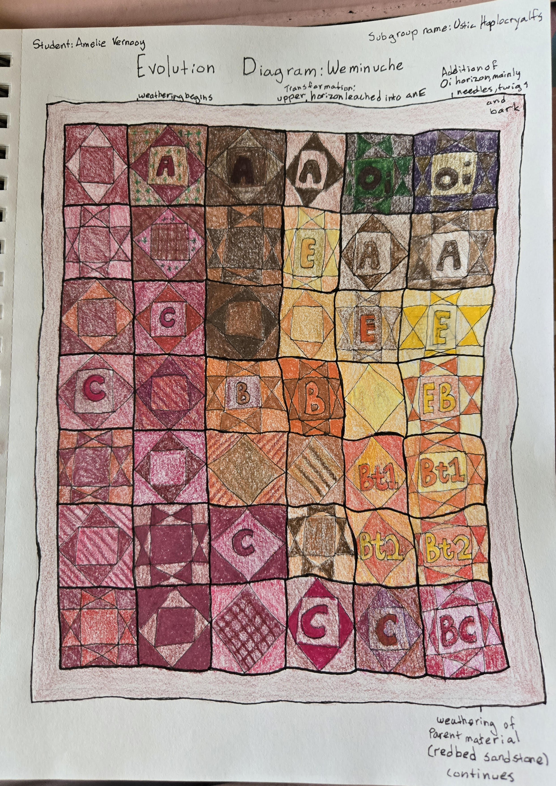

## Classification
| Level | Name |
| --- | --- |
| Series: | Weminuche |
| Order: | Alfisols |
| Suborder: | Cryalfs |
| Great group: | Haplocryalfs |
| Subgroup: | Ustic Haplocryalfs |
| Family: | Fine-loamy, mixed, superactive Ustic Haplocryalfs |

## DRoCTS+ table

| Horizon | Depth (in) | Rocks (%) | Color (dry) | Texture | Structure | Effervescence (HCl) | pH |
| --- | --- | --- | --- | --- | --- | --- | --- | 
| Oi |	0-2	|	Not Given |	p	| -	| ne | 5.6 |
| A	| 2-4	| 6%	| 5YR 3/3	| l/fsl	| pl/gr	| ne	| 7.2 |
| E	| 4-11	| 6% |	5YR 3/4 |	l/fsl |	sbk/gr |	ne	| 7.0 |
| E/B	| 11-21	| 8% | E: 5YR 4/4 B: 2.5YR 3/6 |	E: l/fsl B: l, scl, cl |	sbk/gr |	ne	| 6.8 |
| Bt1	| 21-34	| 14%	| 2.5YR 3/6	| cl	| pris/sbk | ne	| 6.8 |
| Bt2	| 34-44	| 21%	| 2.5YR 4/6	| gr/cl	| pris/sbk	| ne | 6.6 |
| BC	| 44-62	| 14%	| 2.5YR 4/6	| cl	| sbk/gr	| ne	| 6.6 |

Texture: l = loam, fsl = fine sandy loam, cl = clay loam, gr/cl = gravelly clay loam, scl = sandy clay loam

Structure: pl = platy, gr = granular, sbk = subangular blocky, pris = prismatic

## Drocts+ Table As Submitted to Canvas:

## How It Formed + Evolutionary Diagram: 

## Andy Guelcher's written DRoCTS+ table, scored

## Annual water budget of Weminuche and Mountwow, compared

The Weminuche and Mountwow soil series both begin the year in a surplus with regards to their annual water budget, although where they start differs considerably (at 60 mm of water for Weminuche, at 370 mm of water for Mountwow). Both have a use period in the middle of the year, although the use period for Weminuche is longer, three months to Mountwow’s one. Knowing these facts, it is unsurprising that the Weminuche soil series goes into deficit during the year while the Mountwow soil does not. In a single year, Mountwow moves from surplus (6 months) to recharge (1 month) to use (1 month) and then back to recharge (1 month) and surplus again (3 months). The Weminuche series has an annual cycle of surplus (5 months), use (3 months), deficit (1 month), and recharge (2 months) before returning to surplus (1 month). 

## Second comparison

With regards to plant-available water, both the Weminuche soil series and the Wauseon soil series benefit from the presence of organic matter and a lack of rocks, meaning their PAW is likely higher than calculated. However, the calculator does not take organic matter into account, and although the Wauseon soil series is calculated to hold around 11.8 cm of water while the Weminuche soil is calculated to hold around 16.9 cm of water, I believe that as a mollisol the Wauseon soil’s organic matter would have a significant effect upon its plant-available water which the alfisol Weminuche lacks. I think it is very likely that in reality, the Wauseon soil series would have more plant-available water than the Weminuche soil series. 

## Sources

- Soil Survey Staff, USDA-NRCS. Official Soil Series Descriptions: Weminuche series. https://soilseries.sc.egov.usda.gov/OSD_Docs/W/WEMINUCHE.html. Accessed 1 Oct. 2026.
- California Soil Resource Lab, UC Davis. [SoilWeb](https://casoilresource.lawr.ucdavis.edu/gmap/). Accessed 1 Oct. 2026.

Sources for the 3D evolution timeline (the "Play its history" button on the model above). These were found, read and summarized by Claude, Anthropic's AI assistant, on 12 Oct. 2026, and were used only for that timeline graphic:

- Claude (Opus 5.5 model). Anthropic. Research and design of the 3D evolution timeline for this page, 12 Oct. 2026.
- U.S. Bureau of Reclamation. "Lemon Dam" (geology: Cutler Formation). [usbr.gov](https://www.usbr.gov/projects/index.php?id=163). Accessed 12 Oct. 2026.
- Hullaster, D. P., G. S. Soreghan, R. K. Kukkadapu, B. S. Dumont, K. T. Dee, and A. S. Elwood Madden. "Red-green-bleached redox interfaces in the proximal Permian Cutler red beds: implications for regional fluid alteration." *Frontiers in Earth Science* 11, 2023. [frontiersin.org](https://www.frontiersin.org/journals/earth-science/articles/10.3389/feart.2023.1219966/text). Accessed 12 Oct. 2026.
- U.S. Forest Service. "Glacial Activity" (Pinedale glaciation). [fs.usda.gov](https://www.fs.usda.gov/r04/recreation/geologic-wonders/glacial-activity). Accessed 12 Oct. 2026.
- Guido, Z. S., D. J. Ward, and R. S. Anderson. "Pacing the post-Last Glacial Maximum demise of the Animas Valley glacier and the San Juan Mountain ice cap, Colorado." *Geology* 35, no. 8 (2007): 739-742. [University of Arizona listing](https://experts.arizona.edu/en/publications/pacing-the-post-last-glacial-mximum-demise-of-the-animas-valley-g/). Accessed 12 Oct. 2026.
