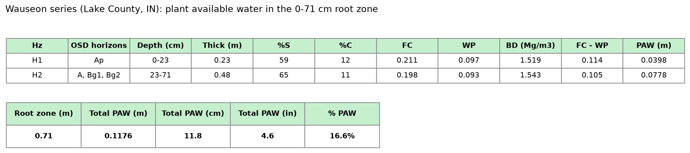

# PAW for the Wauseon Soil

By Andy Guelcher on October 22, 2026

The root zone of the Wauseon soil holds about 11.8 cm (4.6 inches) of plant available water. That comes out to 16.6% PAW across the 71 cm root zone.

## How I got there

Plant Available Water (PAW), the water plants can actually use, is the water a soil holds between field capacity, which is what's left after gravity drains it, and the wilting point, where the leftover water is held too tightly for roots to pull it out. PAW = Field Capacity − Wilting Point.

**The root zone:** Wauseon is described with "few fine roots" from the Ap down to the Bg2 horizon. Bg2 ends at 71 cm, so the root zone is 0–71 cm. Below that is a thin 10 cm Bg3 horizon, then the 2BC at 81 cm, and at 91 cm the dense, clay-heavy glacial till horizons (2C and 2Cd).

**Textures:** SoilWeb's data groups the soil into three layers, labeled H1–H3. H1 (the Ap) is 59% sand and 12% clay. H2 (the A through Bg3) is 65% sand and 11% clay. H3 (from the 2BC on down) is 5% sand and 45% clay.

For field capacity and wilting point, I entered H1's and H2's sand and clay into the CDM Smith Soil Hydraulic Properties Calculator.

**H1 (0–23 cm):**

- Field Capacity: 0.211
- Wilting Point: 0.097
- Bulk Density: 1.519 g/cm³

**H2 (23–71 cm):**

- Field Capacity: 0.198
- Wilting Point: 0.093
- Bulk Density: 1.543 g/cm³

**PAW for H1–H2** = (FC − WP) × Bulk Density × Thickness

- H1: (0.211 − 0.097) × 1.519 × 0.23 m = 0.0398 m
- H2: (0.198 − 0.093) × 1.543 × 0.48 m = 0.0778 m
- Total: 0.0398 + 0.0778 = 0.118 m = 11.8 cm (about 4.6 inches)
- % PAW: 0.118 m ÷ 0.71 m = 16.6%

## Rocks/Organic Material

In reality, the calculator is not perfect because it doesn't consider rocks or organic matter, both of which can affect PAW, or water held by the soil in general. Organic matter raises PAW specifically because it acts like a sponge on the upper horizons. Wauseon is a mollisol with a high amount of organic rich A-horizon material. It's about 4% organic material on SoilWeb. The top of the root zone likely holds more water than calculated.

Rocks lower PAW. However, Wauseon has 5% rocks at the most in any of its horizons, and only 1% rock at maximum in the actual range where roots can grow. The organic matter is far more influential on the soil than the presence of coarse material. The true PAW is likely a bit higher than the calculated 11.8 cm.

## Sources

- Soil Survey Staff, USDA-NRCS. Official Series Description: Wauseon Series. https://soilseries.sc.egov.usda.gov/OSD_Docs/W/WAUSEON.html
- California Soil Resource Lab, UC Davis. Soil Data Explorer: Wauseon. https://casoilresource.lawr.ucdavis.edu/sde/?series=wauseon
- CDM Smith. Soil Hydraulic Properties Calculator (Saxton et al., 1986). http://www.dynsystem.com/netstorm/soilwater.html
- ENSC 245 PAW spreadsheet, Lecture 13. https://tinyurl.com/pawquestion57
