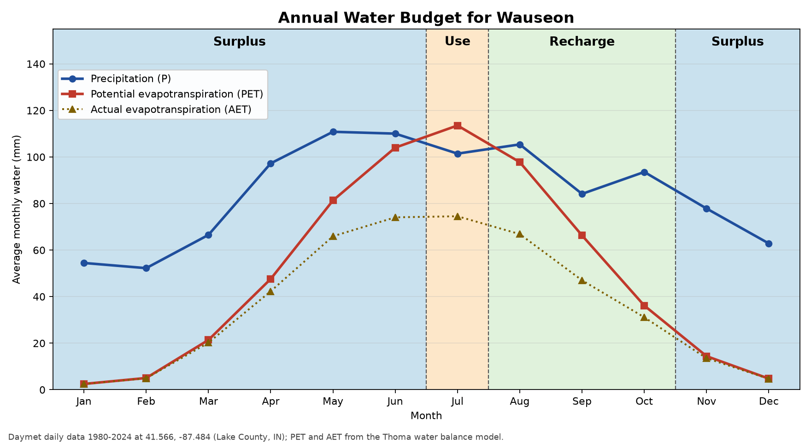

# Annual Water Budget for Wauseon

By Andy Guelcher on October 22, 2026

Wauseon gets about 1,017 mm of precipitation a year on average, compared to about 595 mm of potential evapotranspiration, so for most of the year there is more water coming in than the soil and plants can get rid of. It is in surplus from November all the way through June. July is the only month where PET passes precipitation, so that is the one month of use, and it only uses about 12 mm. August through October is recharge as the soil fills back up before going into surplus again. There is no deficit at all, which makes sense for a soil that is known for being so wet and poorly drained.

If Wauseon were hit by a drought, the problem would mostly show up in the summer, when the July use period would get longer and deeper and could actually turn into a deficit right when corn and soybeans need the most water. As a land manager the first thing I would do is take advantage of the drainage tile that most farmed Wauseon already has. Normally the tile is there to get rid of extra water in the spring, but with a control structure on the outlet you can raise the water table and hold that spring surplus in the soil for later in the summer instead of sending it down the ditch. Second, I would cut down on how much water is lost to evaporation by going no-till and leaving crop residue on the surface, since increased ET is a big part of what a drought does. Long term, building up organic matter would help too, since like I found in my last post the root zone only holds about 11.8 cm of plant available water and organic matter is what raises that. If it got really bad, the sandy top layers don't store much water, so some irrigation in July and August might be needed to get the crop through.

Sources:

- Thornton, M.M., R. Shrestha, Y. Wei, P.E. Thornton, S-C. Kao, and B.E. Wilson. 2022. Daymet: Daily Surface Weather Data on a 1-km Grid for North America, Version 4 R1. ORNL DAAC, Oak Ridge, Tennessee, USA. https://doi.org/10.3334/ORNLDAAC/2129
- Thoma, D. (National Park Service). Thoma Excel Model Daymet_Penman_Hamon_Batch_v9, adapted for ENSC 245. https://tinyurl.com/Thoma9
- Thoma, D., Munson, S., & Witwicki, D. 2019. Landscape pivot points and responses to water balance in national parks of the southwest US. Journal of Applied Ecology, 56(1), 157–167. https://besjournals.onlinelibrary.wiley.com/doi/full/10.1111/1365-2664.13250
- Soil Survey Staff, USDA-NRCS. Official Series Description: Wauseon Series. https://soilseries.sc.egov.usda.gov/OSD_Docs/W/WAUSEON.html
