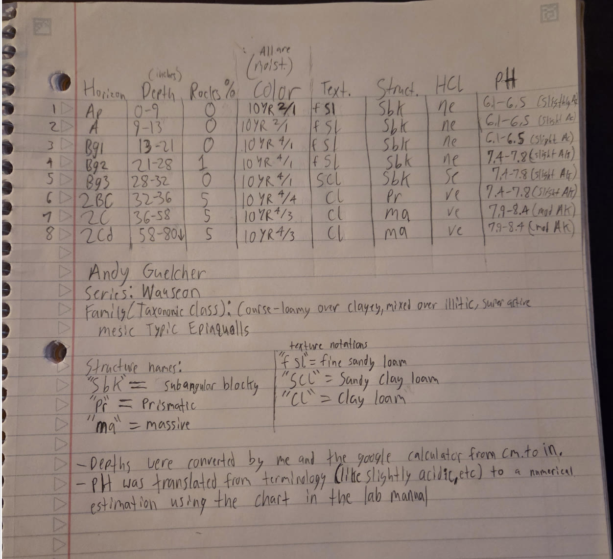
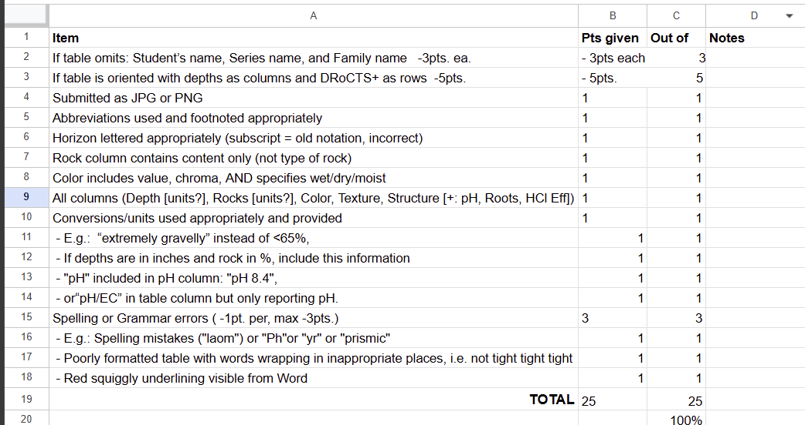
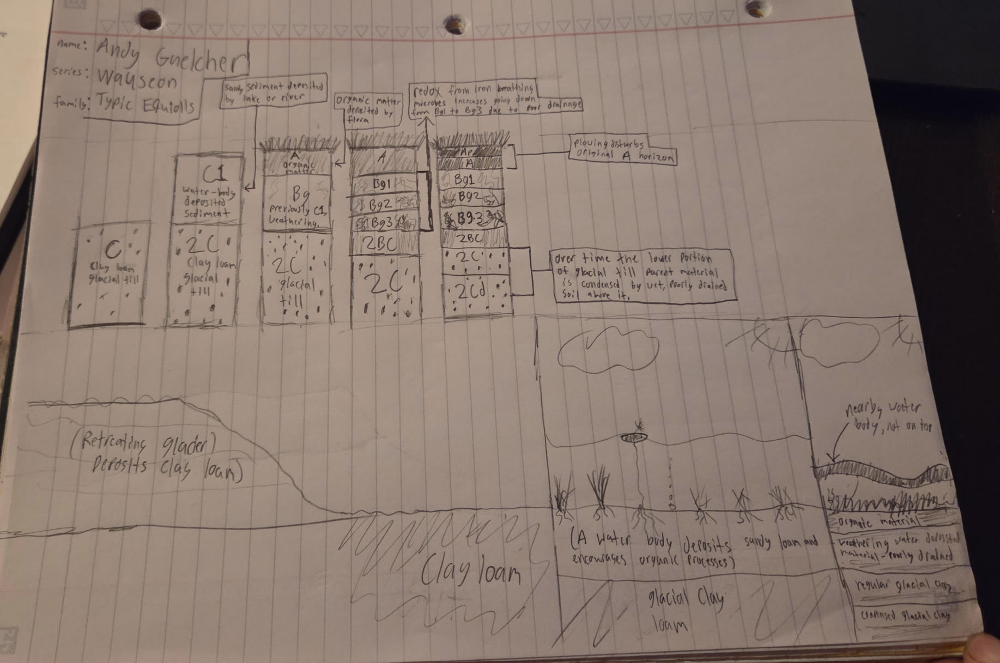

## Classification

| Level | Name |
| --- | --- |
| Series | Wauseon |
| Order | Mollisols |
| Suborder | Aquolls |
| Great group | Epiaquolls |
| Subgroup | Typic Epiaquolls |
| Family | Coarse-loamy over clayey, mixed over illitic, superactive, mesic Typic Epiaquolls |

## DRoCTS+ table

| Horizon | Depth (in) | Rocks (%) | Color (moist) | Texture | Structure | HCl | pH |
| --- | --- | --- | --- | --- | --- | --- | --- |
| Ap | 0–9 | 0 | 10YR 2/1 | fsl | sbk | ne | 6.1–6.5 |
| A | 9–13 | 0 | 10YR 2/1 | fsl | sbk | ne | 6.1–6.5 |
| Bg1 | 13–21 | 0 | 10YR 4/1 | fsl | sbk | ne | 6.1–6.5 |
| Bg2 | 21–28 | 1 | 10YR 4/1 | fsl | sbk | ne | 7.4–7.8 |
| Bg3 | 28–32 | 0 | 10YR 4/1 | scl | sbk | se | 7.4–7.8 |
| 2BC | 32–36 | 5 | 10YR 4/4 | cl | pr | ve | 7.4–7.8 |
| 2C | 36–58 | 5 | 10YR 4/3 | cl | ma | ve | 7.9–8.4 |
| 2Cd | 58–80 | 5 | 10YR 4/3 | cl | ma | ve | 7.9–8.4 |

Texture: fsl, fine sandy loam; scl, sandy clay loam; cl, clay loam. Structure: sbk, subangular blocky; pr, prismatic; ma, massive.

Depths converted from centimetres to inches. pH ranges estimated from the reaction classes in the series description using the lab manual chart.

## Katherine Kovich's DRoCTS+ table, scored

## How it formed

1. A retreating glacier leaves clay loam till, the parent material at the base of the profile.
2. A lake or river lays sandy sediment over the till, giving the soil its second parent material.
3. Plants add organic matter at the surface and an A horizon builds while the sediment beneath begins to weather.
4. Poor drainage keeps the subsoil wet. Redox by iron-reducing microbes greys the Bg horizons, more so with depth.
5. Plowing mixes the top of the A into an Ap, and the lower till is densified into 2Cd beneath the wet soil above.

## Annual water budget, compared

TO DO: Compare this soil's water balance with one groupmate's (individual, 30 of the 50 report points). Show or link both abSURD graphs, say which of surplus, use, recharge and deficit each soil has and how much, and explain why they differ.

## Second comparison

TO DO: The group picks one: plant-available water, physical properties and water holding, wind and water erosion, role in the hydrologic cycle, or land use and management.

## Sources

- Soil Survey Staff, USDA-NRCS. Official Soil Series Descriptions: Wauseon series. https://soilseries.sc.egov.usda.gov/OSD_Docs/W/WAUSEON.html. Accessed 2 Oct. 2026.
- California Soil Resource Lab, UC Davis. [SoilWeb](https://casoilresource.lawr.ucdavis.edu/gmap/). Accessed 2 Oct. 2026.

Sources for the 3D evolution timeline (the "Play its history" button on the model above). These were found, read and summarized by Claude, Anthropic's AI assistant, on 12 Oct. 2026, and were used only for that timeline graphic:

- Claude (Opus 5.5 model). Anthropic. Research and design of the 3D evolution timeline for this page, 12 Oct. 2026.
- Wikipedia contributors. "Lake Maumee," citing Leverett, F., and F. B. Taylor, *The Pleistocene of Indiana and Michigan*, USGS Monograph 53, 1915. [en.wikipedia.org/wiki/Lake_Maumee](https://en.wikipedia.org/wiki/Lake_Maumee). Accessed 12 Oct. 2026.
- Ohio Department of Natural Resources. *Ohio Coastal Atlas*, 3rd ed., Chapter 9: Geology. [Ohio Coastal Atlas, Geology](https://dam.assets.ohio.gov/image/upload/ohiodnr.gov/documents/coastal/ohio-coastal-atlas/CH09_Geology.pdf). Accessed 12 Oct. 2026.
- Blockland, J. D., and T. G. Fisher. "The surficial geology of the Delta 7.5-minute series quadrangle, Fulton County, Ohio, USA." *Journal of Maps* 12, no. 5 (2016): 731-735. [University of Toledo listing](https://scholars.utoledo.edu/display/pub-WOS000389542600004). Accessed 12 Oct. 2026.
- Soil Survey Staff. *Keys to Soil Taxonomy*, 13th ed. USDA-NRCS, 2022 (densic materials). [Keys to Soil Taxonomy](https://Nrcs.usda.gov/sites/default/files/2022-09/Keys-to-Soil-Taxonomy.pdf). Accessed 12 Oct. 2026.
- University of Maine, Bear Brook Watershed in Maine. "Soil Morphology and Chemistry" (dense basal till). [umaine.edu/bbwm](https://umaine.edu/bbwm/?p=99). Accessed 12 Oct. 2026.
- H2Ohio. "History of the Great Black Swamp." State of Ohio. [History of the Great Black Swamp](https://dam.assets.ohio.gov/image/upload/h2.ohio.gov/STA/History_of_the_Great_Black_Swamp.pdf). Accessed 12 Oct. 2026.
- Library of Congress. "Draining America." *Worlds Revealed* blog, Feb. 2024. [blogs.loc.gov](https://blogs.loc.gov/maps/2024/02/draining-america/). Accessed 12 Oct. 2026.
