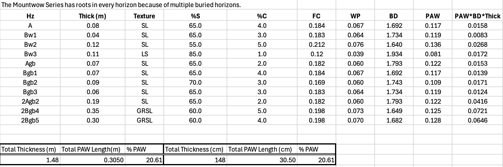

# Mountwow PAW

By Katherine Kovich on October 19, 2026

PAW was calculated using the CDM Soil Hydraulic Properties Calculator which displays an estimated Field Capacity, Wilting Percentage, and Soil Bulk Density based on each horizon's percent sand and clay. Once these fields were calculated, I calculated PAW using the formula, PAW=FC-WP for each horizon. These values were each multiplied by the horizon's soil density and thickness. The sum of these values is the total PAW length of Mountwow. The PAW % was calculated by dividing the total PAW length by the total thickness of the root horizons, multiplied by 100.

The CDM Soil Hydraulic Properties Calculator does a great job in calculating wilting point, field capacity, and bulk density by using the relative percentages of sand and clay in each horizon. But this model does not take rock content or organic matter into consideration. The Mountwow series has rocks present in about half of the horizons, with the deepest horizons containing 45-50% rock content. The porosity and permeability of rocks are much different than soil. Soil is able to hold much more water in between grains, especially silt and clay sized particles. Rocks cannot hold nearly as much water in between grains because of their size and density. Because rocks have a much lower porosity and permeability compared to soil, their presence would decrease the PAW. On the other hand, organic matter needs water to survive. Mountwow has an Oi horizon, indicating lots of organic matter at the surface from the large amounts of vegetation. Organic matter increaes the soil's ability to soak up water, increasing the PAW. 

Sources:
K.E. Saxton et al., 1986, Estimating generalized soil-water characteristics from texture. Soil Sci. Soc. Amer. J. 50(4):1031-1036. http://www.dynsystem.com/netstorm/soilwater.html?34,125, 19 Oct. 2026.
“Soil Data Explorer - MOUNTWOW.” Soil Data Explorer | California Soil Resource Lab, UC Davis, soilmap2-1.lawr.ucdavis.edu/sde/?series=mountwow#osd. Accessed 14 Sept. 2026.
Soil Survey Staff, Natural Resources Conservation Service, United States Department of Agriculture. Web Soil Survey. websoilsurvey.sc.egov.usda.gov/App/WebSoilSurvey.aspx. Accessed 14 Sept. 2026.
