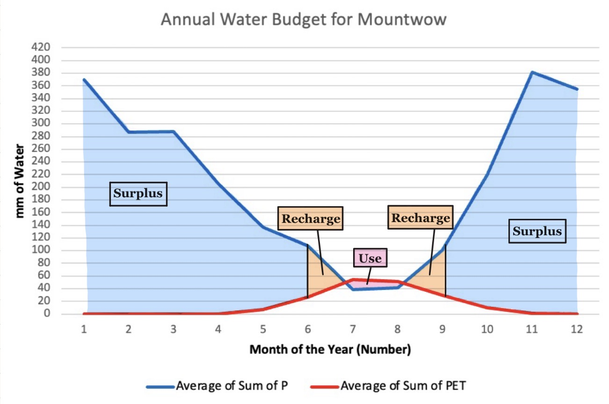

# Annual Water Budget for the Mountwow Soil Series
By Katherine Kovich on October 22, 2026

A severe drought near Mount Rainier would impact the Mountwow Soil Series. As a farmer, I would only be concerned if the drought was severe because the moisture regime for my soil is aquic which holds a surplus of water for 8 months of the year. However, the way I would mitigate the effects of the decrease in precipitation and the increase in evapotranspiration would be to add a layer of mulch to the top of my crops. This layer of mulch would reduce the soil temperature by shielding the horizons below from the increase in sunlight. It would also act as a natural barrier so less water would be pulled from the soil roots with the increase in evapotranspiration. Additionally, mulch adds organic content to the soil which would increase Mountwow's water field capacity (Drought Resistant). 

Citations:
- “Drought Resistant Practices.” Drought Resistant Practices | USDA Climate Hubs, U.S. Department of Agriculture, climatehubs.usda.gov/hubs/northeast/topic/drought-resistant-practices. Accessed 22 Oct. 2026. 
- “Single Pixel Extraction Tool.” Daymet, NASA, daymet.ornl.gov/single-pixel/. Accessed 22 Oct. 2026. 
- “Soil Data Explorer - MOUNTWOW.” Soil Data Explorer | California Soil Resource Lab, UC Davis, soilmap2-1.lawr.ucdavis.edu/sde/?series=mountwow#osd. Accessed 14 Sept. 2026.
