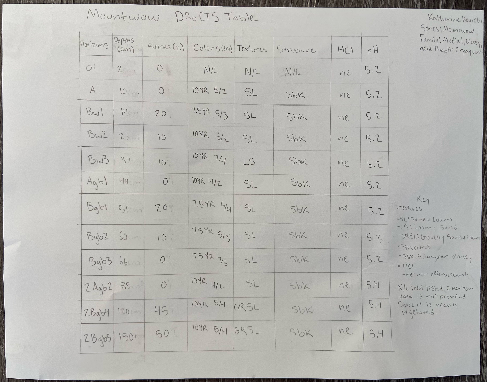
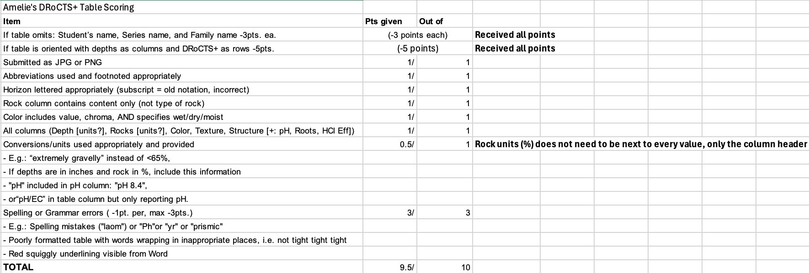
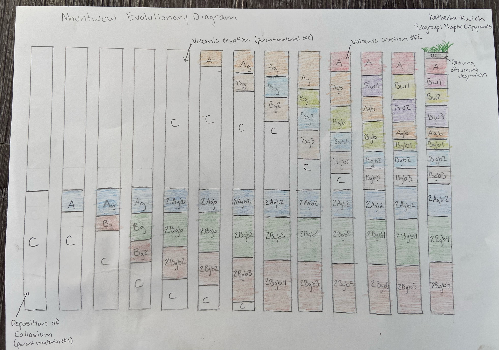

## Classification

| Level | Name |
| --- | ---|
| Series | Mountwow |
| Order | Andisols |
| Suborder | Aquands |
| Great group | Cryaquands |
| Subgroup | Thaptic Cryaquands |
| Family | Medial, glassy, acid Thaptic Cryaquands |

## DRoCTS+ table

| Horizon | Depth (cm) | Rocks (%) | Colors (Dry) | Textures | Structure | HCl | pH |
| --- | --- | --- | --- | --- | --- | --- | --- |
| Oi | 2 | 0 | N/A | N/A | N/A | ne | 5.2 |
| A | 10 | 0 | 10YR 5/2 | sl | sbk | ne | 5.2 |
| Bw1 | 14 | 20 | 7.5YR 5/3 | sl | sbk | ne | 5.2 |
| Bw2 | 26 | 10 | 10YR 6/2 | sl | sbk | ne | 5.2 |
| Bw3 | 37 | 10 | 10YR 7/4 | ls | sbk | ne | 5.2 |
| Agb1 | 44 | 0 | 10YR 4/2 | sl | sbk | ne | 5.2 |
| Bgb1 | 51 | 20 | 7.5YR 5/4 | sl | sbk | ne | 5.2 |
| Bgb2 | 60 | 10 | 7.5YR 5/3 | sl | sbk | ne | 5.2 |
| Bgb3 | 66 | 0 | 7.5YR 7/6 | sl | sbk | ne | 5.2 |
| 2Agb2 | 85 | 0 | 10YR 4/2 | sl | sbk | ne | 5.4 |
| 2Bgb4 | 120 | 45 | 10YR 5/4 | grsl | sbk | ne | 5.4 |
| 2Bgb5 | 150 | 50 | 10YR 5/4 | grsl | sbk | ne | 5.4 |

Texture: sl, sandy loam; ls, loamy sand; grsl, gravelly sandy loam.
Structure: sbk, subangular blocky.

## A groupmate's table, scored

## How it formed

1. Colluvium was deposited aided by water and gravity

2. First volcanic eruption occurs depositing tephra, volcanic glass, and pumice

3. Second volcanic eruption occurs depositing more tephra, volcanic glass, and pumice

4. Vegetation grows and accumulates into the Oi horizon

## Annual water budget, compared

TO DO: Compare this soil's water balance with one groupmate's. Say which of surplus, use, recharge and deficit each soil has and how much, and explain why they differ.

## Second comparison

TO DO: The group picks one: plant-available water, physical properties and water holding, wind and water erosion, role in the hydrologic cycle, or land use and management.

## Sources

“Soil Data Explorer - MOUNTWOW.” Soil Data Explorer | California Soil Resource Lab, UC Davis, soilmap2-1.lawr.ucdavis.edu/sde/?series=mountwow#osd. Accessed 14 Sept. 2026. 

Soil Survey Staff, Natural Resources Conservation Service, United States Department of Agriculture. Web Soil Survey. websoilsurvey.sc.egov.usda.gov/App/WebSoilSurvey.aspx. Accessed 14 Sept. 2026. 

Sources for the 3D evolution timeline (the "Play its history" button on the model above). These were found, read and summarized by Claude, Anthropic's AI assistant, on 12 Oct. 2026, and were used only for that timeline graphic:

- Claude (Opus 5.5 model). Anthropic. Research and design of the 3D evolution timeline for this page, 12 Oct. 2026.
- Soil Survey Staff, USDA-NRCS. Official Soil Series Descriptions: Mountwow series (tephra layers named in REMARKS). [soilseries.sc.egov.usda.gov](https://soilseries.sc.egov.usda.gov/OSD_Docs/M/MOUNTWOW.html). Accessed 12 Oct. 2026.
- Crandell, D. R. *Surficial Geology of Mount Rainier National Park, Washington*. USGS Bulletin 1288, 1969 (Evans Creek glaciation, about 25,000 to 15,000 years ago). [npshistory.com](https://npshistory.com/publications/geology/bul/1288/sec5b.htm). Accessed 12 Oct. 2026.
- Jensen, B. J. L., and others. "A re-examination of the three most prominent Holocene tephra deposits in western Canada: Bridge River, Mount St. Helens Yn and Mazama." *Quaternary International*, 2019. [researchgate.net](https://www.researchgate.net/publication/332083288_A_re-examination_of_the_three_most_prominent_Holocene_tephra_deposits_in_western_Canada_Bridge_River_Mount_St_Helens_Yn_and_Mazama). Accessed 12 Oct. 2026.
- National Park Service. "Tephra Explorer." [nps.gov](https://www.nps.gov/teachers/classrooms/tephra-explorer.htm). Accessed 12 Oct. 2026.
- Vallance, J. W., and K. M. Scott. "The Osceola Mudflow from Mount Rainier." *GSA Bulletin*, 1997. [morageology.com](https://www.morageology.com/pubs/59.pdf). Accessed 12 Oct. 2026.
- U.S. Geological Survey. "A latest Pleistocene and Holocene composite tephrostratigraphic framework for northeastern North America" (age of Mount St. Helens set P). [usgs.gov](https://www.usgs.gov/publications/a-latest-pleistocene-and-holocene-composite-tephrostratigraphic-framework-northeastern). Accessed 12 Oct. 2026.
- Sisson, T. W., and J. W. Vallance. "Frequent eruptions of Mount Rainier over the last ~2,600 years." *Bulletin of Volcanology*, 2009. [morageology.com](https://www.morageology.com/pubs/52.pdf). Accessed 12 Oct. 2026.
